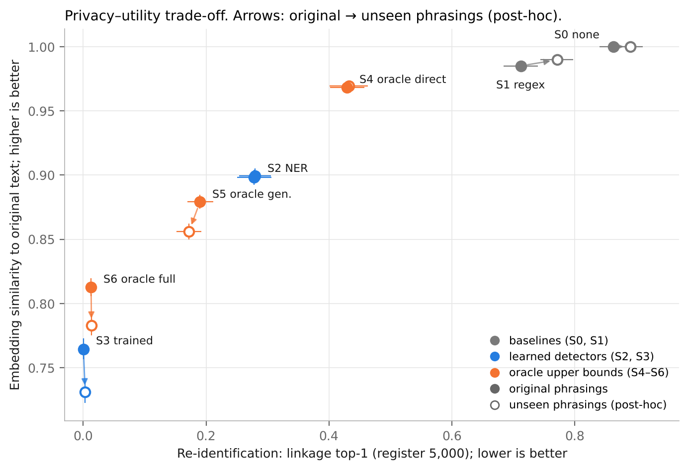

# Semantic Privacy Lab

**How much does text anonymization actually protect, and what does it cost?** A controlled measurement of the
privacy–utility trade-off of seven anonymization strategies against two re-identification attacks, on a synthetic
population where the author of every text and every identifying span is known exactly.

Technical report: [`docs/REPORT.md`](docs/REPORT.md) · Methodology and reviewer questions:
[`docs/STUDY_GUIDE.md`](docs/STUDY_GUIDE.md) · Preregistration: [`docs/PREREGISTRATION.md`](docs/PREREGISTRATION.md)

## Why
Masking names and e-mail addresses is the default "anonymization" in many pipelines. People are also identified by
combinations of ordinary facts ("a 34-year-old paramedic in Coldridge") and by context ("the only baker on Mill
Lane"). On real data neither the true author nor the full set of identifying spans is known, so how often a strategy
fails cannot be measured. A synthetic population makes both known, so detection errors, residual
re-identification risk and utility loss can be measured for each strategy on identical inputs.

## Setup
- **Population**: 20,000 fictional people with skewed attribute frequencies (`src/spl/population.py`).
- **Tickets**: support requests to a fictional utility company with a request category, task facts (amounts, dates)
  and 1–4 identity mentions at three levels: direct (name, e-mail, phone), quasi (age, town, occupation, employer),
  contextual (club role, arrival year, street). 20% are typed in lowercase. 2,400 training and 800 test tickets
  from disjoint authors.
- **Strategies**: S0 none · S1 regex · S2 off-the-shelf NER (`dslim/bert-base-NER`) + regex · S3 DistilBERT span
  detector trained on the training tickets' gold spans + regex · S4 oracle masking of direct identifiers ·
  S5 S4 + generalization of quasi-identifiers (age band, region, sector, employer type) · S6 S5 + suppression of
  contextual clues. S4–S6 use gold spans: they are upper bounds on detection, not deployable systems.
- **Attacks**: A1 attribute linkage against a population register of 1k / 5k / 20k people (IDF-weighted matching
  of every value readable in the text); A2 dense retrieval with `all-MiniLM-L6-v2`.
- **Utility**: request-category macro-F1; share of task facts kept; embedding similarity to the original text;
  share of non-identity words kept (over-masking; post-hoc).
- **Uncertainty**: 95% bootstrap intervals over test tickets; paired differences where arms share tickets.

## Results
The protocol is documented in Git before the archived Run 1 results. The early commits share a timestamp.
The decision rules were operationalized after Run 1.

Linkage re-identification (top-1, register of 5,000 people) and embedding similarity to the original text, 800 test
tickets. "Original" is the preregistered run 1; "unseen phrasings" is the post-hoc test set in which the same
authors use 15 templates absent from training.

| Strategy | Re-identification, original | Re-identification, unseen phrasings (post-hoc) | Similarity, original |
|---|---|---|---|
| S0 none | 0.863 [0.840, 0.883] | 0.891 [0.871, 0.911] | 1.000 |
| S1 regex | 0.712 [0.684, 0.740] | 0.772 [0.744, 0.798] | 0.985 |
| S2 off-the-shelf NER | 0.279 [0.254, 0.305] | 0.278 [0.251, 0.307] | 0.899 |
| S3 trained detector | 0.000 [0.000, 0.000] | 0.003 [0.002, 0.004] | 0.765 |
| S4 oracle, direct identifiers | 0.429 [0.402, 0.458] | 0.433 [0.401, 0.464] | 0.968 |
| S5 oracle, + generalization | 0.190 [0.170, 0.211] | 0.172 [0.152, 0.192] | 0.879 |
| S6 oracle, + context suppression | 0.013 [0.010, 0.015] | 0.013 [0.011, 0.016] | 0.813 |

**Preregistered hypotheses** (decision rules in [`results/analysis/ANALYSIS.md`](results/analysis/ANALYSIS.md)):
- **H1 supported.** Perfect masking of direct identifiers (S4) leaves 43% of authors re-identifiable from ordinary
  facts; when age, occupation and street are all readable, 79% of these authors are found (31 tickets).
- **H2 supported.** Off-the-shelf NER re-identifies more than the trained detector. It masks most capitalized
  names but never ages or occupations, and fails on lowercase text (0.654 vs. 0.178 on cased tickets).
- **H3 partly testable.** Category F1 is 1.000 for every strategy (the request sentence never overlaps an identity
  span), so "generalization costs less utility than it saves privacy" cannot be tested with it; task facts are
  preserved by every strategy.
- **H4 supported.** Risk falls with register size for every strategy (S4: 0.580 / 0.429 / 0.320 at 1k / 5k / 20k).
- Preregistered breakdown by rarity: under S5, authors whose generalized attributes are unique in the register are
  re-identified at 0.363, those in classes of more than 20 at 0.141.

**Post-hoc findings** ([`docs/REPORT.md`](docs/REPORT.md), section 4):
- Run 2 reproduces the run-1 point estimates at the reported precision. The saved per-ticket attack outcomes match exactly.
- The trained detector generalizes in aggregate: 0.003 on unseen phrasings, and 0.000 / 0.005 on a new population
  with unseen names, towns, occupations, employers, clubs and streets. The suspicion that its run-1 result reflected
  memorized values is not supported.
- Its failures are systematic but low-impact here: on unseen phrasings it leaves 51% of ages unmasked (69% in one
  template) and deletes 1.7% of non-identity words; on the original phrasings, 1% and 0%.
- Every reduction in re-identification costs embedding similarity, in the same order (Spearman ρ = 1.00).



## Repository
| Path | Content |
|---|---|
| `src/spl/` | Population and ticket generator, strategies, S3 detector, attacks |
| `scripts/run_experiment.py` | Full pipeline: data, anonymization, attacks, utility, bootstrap |
| `scripts/analyze.py` | Hypothesis checks, breakdowns, post-hoc analyses, figures (no model runs) |
| `scripts/probe_unseen_values.py` | Post-hoc probe with attribute values unseen in training |
| `results/run1_preregistered_only/` | Preregistered run (unchanged) |
| `results/run2/` | Run 2: run 1 + unseen phrasings + over-masking metric; all anonymized texts |
| `results/probe_unseen_values/` | Probe results |
| `results/analysis/` | `ANALYSIS.md`, `analysis.json`, figures |
| `data/` | Synthetic population and tickets with gold spans; hashes in `manifest.json` |

## Reproduce
```bash
pip install --index-url https://download.pytorch.org/whl/cpu torch==2.5.1
pip install -r requirements.txt
python -m pytest -q
SPL_THREADS=4 SPL_SAVE_DETECTOR=logs/s3_detector python scripts/run_experiment.py configs/experiment.json results/run2
python scripts/probe_unseen_values.py logs/s3_detector
python scripts/analyze.py
```
CPU only; run 2 takes about 15 minutes on 4 threads. Data are regenerated byte-identically from the seed.

## Limitations
Synthetic, template-based English text; a fixed list of clue types; an idealized attacker with a complete, error-free
register and patterns written for the templates; one training seed for the detector. Absolute numbers are not
estimates of real-world risk, and no strategy here carries a formal privacy guarantee. What transfers is the
comparison between strategies and the failure modes they expose. See [`docs/REPORT.md`](docs/REPORT.md), section 6.

## Relation to other work
This is an independent study. It does not reuse code, data or results from MedAnon, the Neural Wave hackathon
team project on clinical de-identification that I contributed to. The two share a theme: anonymization has to be
evaluated with attacks, not only with detection metrics.

## License and AI assistance
MIT for code and the synthetic data. Models are downloaded from Hugging Face under their own licenses
(MIT / Apache-2.0).

I used an AI coding assistant for implementation, analysis and documentation. All reported numbers are produced by the scripts in this repository.
