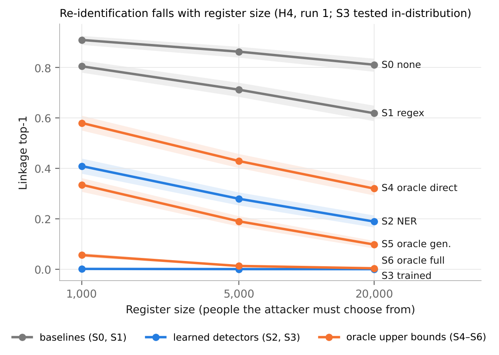
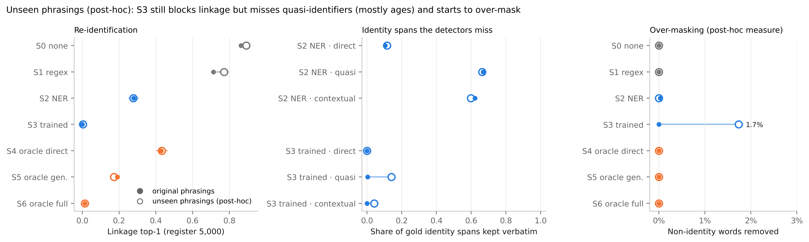
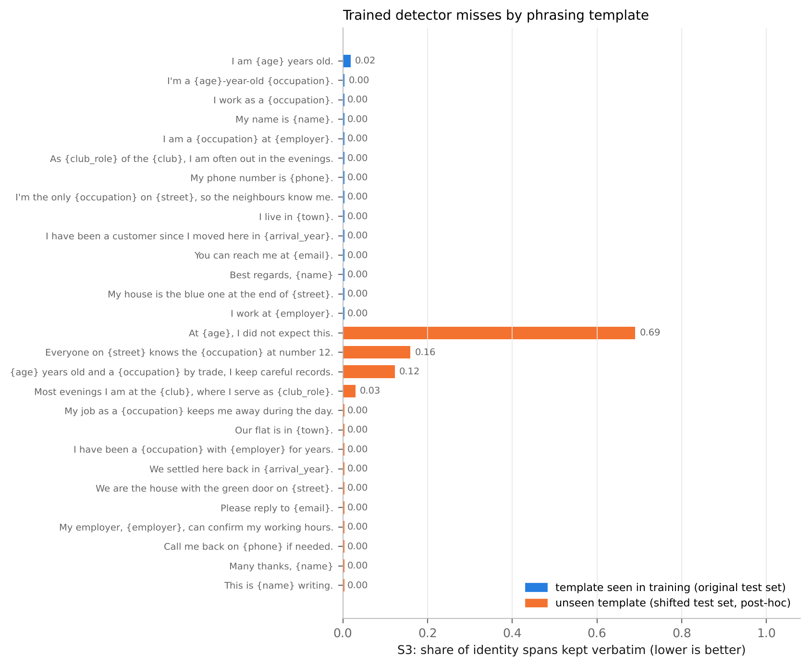
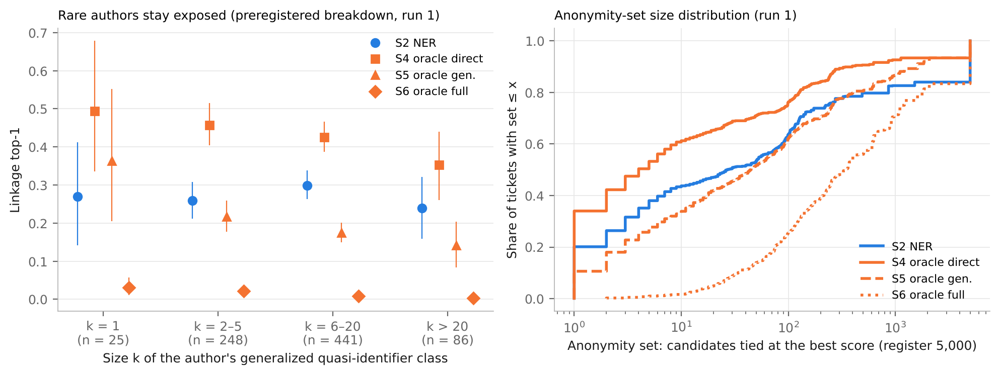
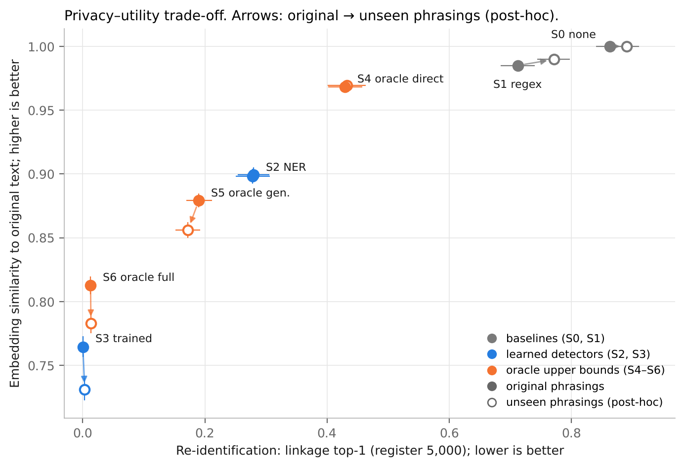

# Semantic Privacy Lab: a controlled measurement of re-identification risk and utility loss in text anonymization

Technical report · November 2026 · all numbers are generated by `scripts/run_experiment.py` (`results/run1_preregistered_only/`,
`results/run2/`), `scripts/analyze.py` (`results/analysis/`) and `scripts/probe_unseen_values.py`
(`results/probe_unseen_values/`).

## Abstract
Seven text-anonymization strategies were applied to 800 synthetic support tickets whose authors and identifying
spans are known exactly, and attacked by an attacker holding a register of 5,000 people. Masking every direct
identifier perfectly (oracle) still let the linkage attack find the author in 43% of tickets (0.429 [0.402, 0.458]),
because ages, occupations, employers, streets and club roles remain. Generalizing quasi-identifiers lowered this to
0.190, and also deleting contextual clues lowered it to 0.013; authors whose generalized attributes are rare stayed
more exposed. An off-the-shelf NER model reached 0.279 overall but 0.654 on lowercase text. A DistilBERT detector
trained on gold spans reached 0.000 on the phrasings it was trained on. In post-hoc tests it kept near-zero
re-identification on 15 unseen phrasing templates (0.003) and on unseen attribute values (0.000), but on unseen
phrasings it left about half of the ages and some occupations and club roles unmasked and deleted 1.7% of
non-identity words. Across strategies, every reduction in re-identification came with an equal-rank reduction in
embedding similarity to the original text. Four hypotheses were preregistered: H1, H2 and H4 are supported; H3 is
partly untestable because the request-category classifier is at ceiling for every strategy. The results are
comparative measurements in a synthetic setting, not estimates of real-world risk, and no strategy carries a formal
privacy guarantee.

## 1. Motivation
Anonymization pipelines are usually evaluated with detection metrics (how many annotated names were found). Two
things are then left unmeasured: whether the text still identifies its author through what was *not* annotated as
an identifier, and how much useful content was removed. Both need ground truth that real data lacks: the true
author, and every span that narrows the candidates. This study builds that ground truth synthetically and measures
the two quantities directly, with an explicit attacker.

## 2. Design
Full rationale, threat model and metric definitions are in [`STUDY_GUIDE.md`](STUDY_GUIDE.md); hypotheses in
[`PREREGISTRATION.md`](PREREGISTRATION.md); data in [`DATASET_CARD.md`](DATASET_CARD.md).

- **Data.** 20,000 fictional people with Zipf-distributed attributes. One ticket per author: 1–4 identity mentions
  (direct: name, e-mail, phone; quasi: age, town, occupation, employer; contextual: club role, arrival year, street)
  from 13 templates, a request sentence (category, amount or date), a closing; 20% lowercase. 2,400 training and
  800 test tickets, disjoint authors.
- **Strategies.** S0 none; S1 regex (e-mail, phone); S2 `dslim/bert-base-NER` + regex; S3 DistilBERT token
  classifier trained 2 epochs on the training tickets' gold identity spans + regex; S4 oracle masking of direct
  identifiers; S5 S4 + oracle generalization of quasi-identifiers; S6 S5 + oracle suppression of contextual clues.
- **Attacks.** A1 linkage: IDF-weighted matching of all values readable in the text against a register of 1k / 5k /
  20k people; top-1 is the expected success under random tie-breaking. A2 dense retrieval with `all-MiniLM-L6-v2`.
- **Utility.** U1 request-category macro-F1 (TF-IDF + logistic regression trained on equally anonymized text);
  U2 task facts kept; U3 embedding similarity to the original; post-hoc: share of non-identity words kept.
- **Statistics.** 95% percentile bootstrap over tickets (1,000 resamples); differences paired by ticket or author.
- **Runs.** Run 1 is the preregistered run. Run 2 re-ran the same pipeline (same seed) and added the post-hoc
  shifted test set: the same 800 authors writing a second ticket whose identity mentions and closings use 15
  templates absent from training. A post-hoc probe then applied the run-2 detector to a new population whose
  names, towns, occupations, employers, clubs and streets are all new.

## 3. Preregistered results (run 1)

| Strategy | Linkage top-1 | Linkage top-5 | Dense top-1 | Median anonymity set | Semantic similarity |
|---|---|---|---|---|---|
| S0 none | 0.863 [0.840, 0.883] | 0.915 | 0.139 | 1 | 1.000 |
| S1 regex | 0.712 [0.684, 0.740] | 0.825 | 0.096 | 1 | 0.985 |
| S2 off-the-shelf NER | 0.279 [0.254, 0.305] | 0.458 | 0.030 | 27 | 0.899 |
| S3 trained detector | 0.000 [0.000, 0.000] | 0.001 | 0.000 | 5,000 | 0.765 |
| S4 oracle, direct | 0.429 [0.402, 0.458] | 0.620 | 0.031 | 4 | 0.968 |
| S5 oracle, + generalization | 0.190 [0.170, 0.211] | 0.370 | 0.001 | 44 | 0.879 |
| S6 oracle, + context suppression | 0.013 [0.010, 0.015] | 0.070 | 0.000 | 337 | 0.813 |

Register of 5,000 people; intervals for the other columns are in `results/run1_preregistered_only/RESULTS.md`.
Category macro-F1 and task facts kept are 1.000 for every strategy.

**Hypotheses.** The preregistration states hypotheses without numeric decision rules; the rules below were written
after run 1 as the literal reading of each sentence (`results/analysis/ANALYSIS.md`, section 2).

| | Hypothesis | Rule | Result | Verdict |
|---|---|---|---|---|
| H1 | Masking direct identifiers alone leaves top-1 > 20% | S4 lower bound > 0.20 | 0.429 [0.402, 0.458] | Supported |
| H2 | Off-the-shelf NER re-identifies more than the trained detector | paired S2 − S3 excludes 0 | 0.279 [0.254, 0.305] | Supported (see 4.2 for the qualification) |
| H3 | Generalization reduces re-identification more than U1; U2 preserved | — | U1 = 1.000 for all; U2 = 1.000 for all | First part not testable (ceiling); second part supported |
| H4 | Re-identification falls with register size for every strategy | strict decrease 1k → 5k → 20k and paired 1k − 20k excludes 0 | e.g. S4 0.580 → 0.429 → 0.320 | Supported (S3 at the floor) |

**Breakdowns (preregistered).**
- *Casing.* S2 re-identifies 0.178 [0.154, 0.202] of normally cased tickets and 0.654 [0.591, 0.718] of lowercase
  ones: the NER model relies on capitalization. The other strategies do not depend on casing.
- *Mention levels.* Under S4, tickets containing quasi and contextual mentions are re-identified at 0.785 (n = 120),
  tickets with only quasi mentions at 0.237 (n = 75). Generalization (S5) brings the former to 0.445 and the latter
  to 0.020; only suppressing context (S6) brings the former to 0.018.
- *Rarity* (computed after run 1 from saved outputs; definition chosen post hoc: size k of the author's equivalence
  class on age band, region, sector and employer type in the 5k register). Under S5, authors with k = 1 are
  re-identified at 0.363 [0.205, 0.553] vs. 0.141 [0.084, 0.204] for k > 20; under S6, 0.031 vs. 0.004. Without
  generalization (S0–S4), rarity of the *generalized* class has little effect, as expected.



## 4. Post-hoc analyses
These analyses were designed after run 1. They are exploratory: intervals describe sampling uncertainty, not
confirmatory tests.

### 4.1 Reproducibility
Run 2 used 4 instead of 6 CPU threads. On the original test set, every saved per-ticket attack outcome
matched across 5,600 strategy–ticket rows, including linkage at all three register sizes and dense retrieval.
All preregistered point estimates agreed at the reported precision. The largest absolute point-estimate
difference was below `3e-8` and occurred in embedding similarity. The attacker's pattern extension for the
shifted set preserved the recorded attack outcomes on the original test set.

### 4.2 Unseen phrasings
| Strategy | Linkage top-1, original | Linkage top-1, unseen phrasings | Paired difference |
|---|---|---|---|
| S2 NER | 0.279 [0.254, 0.305] | 0.278 [0.251, 0.307] | −0.002 [−0.040, 0.036] |
| S3 trained | 0.000 [0.000, 0.000] | 0.003 [0.002, 0.004] | +0.003 [0.002, 0.004] |
| S5 oracle | 0.190 [0.170, 0.211] | 0.172 [0.152, 0.192] | −0.018 [−0.048, 0.012] |

S3's advantage over S2 holds on unseen phrasings (paired S2 − S3 = 0.275 [0.248, 0.304]), so the run-1 concern
that S3's 0.000 only reflected template memorization is not borne out for re-identification. Its *detection*,
however, degrades in specific places (`results/analysis/ANALYSIS.md`, section 4; Figures 2–3):
- 14.0% of quasi-identifier spans and 4.2% of contextual spans survive (0.3% and 0.0% on the original phrasings).
- The misses concentrate on ages (50.7% kept): 69% of ages in "At {age}, I did not expect this." and 12% in
  "{age} years old and a {occupation} by trade" survive, while ages in every training template are masked.
  Occupations (8.1%) and club roles (6.1%) are missed occasionally; names, e-mails, phones, towns, employers, clubs,
  streets and arrival years never.
- Re-identification stays low because what is missed is weak on its own: when only an age remains readable (139
  tickets), linkage top-1 is 0.012; the two tickets where both age and occupation survived reached 0.222.
- S3 starts to over-mask: 1.7% of non-identity words are removed (0.0% on the original phrasings) and the
  character-level precision of its spans falls from 1.000 to 0.933. The spans involved are "12" in "the
  {occupation} at number 12" (111), "trade" in "by trade" (85), "door" (16), and the word after the name in "This is
  {name} writing" (195). The house number is a template literal and therefore not annotated as identity, although
  a real annotator would count it as a contextual clue; that case reflects the annotation scheme rather than a
  detector error.
- Embedding similarity of S3 output falls from 0.765 to 0.731.





### 4.3 Unseen attribute values (probe)
The shifted set reuses the closed vocabulary of values the detector saw in training, so S3 could have memorized
values rather than learned to recognize mentions. A probe with a new population whose names, towns, occupations,
employers, clubs and streets are all new (ages, arrival years and club roles keep their ranges) tests this without
retraining:

| Strategy | Phrasing seen, values seen | Phrasing unseen, values seen | Phrasing seen, values unseen | Both unseen |
|---|---|---|---|---|
| S2 NER | 0.279 | 0.278 | 0.270 | 0.269 |
| S3 trained | 0.000 | 0.003 | 0.000 | 0.005 [0.003, 0.008] |
| S4 oracle | 0.429 | 0.433 | 0.443 | 0.410 |

New values do not degrade S3 (quasi spans kept 0.005 with new values vs. 0.003 with seen values, original
phrasings). The value-memorization explanation is not supported; the measurable weakness is phrasing, and within
phrasing, ages. Each population has its own register, so the probe columns compare strategies, not populations.

### 4.4 What re-identifies authors after anonymization
Grouping tickets by the attribute types the attacker can still read (`ANALYSIS.md`, section 5):
- Under S4, "age + occupation + street" re-identifies 0.788 of 31 tickets, "age + occupation" 0.312 of 60, a single
  quasi-identifier alone ≤ 0.01. Combinations, not single attributes, carry the risk.
- Under S5 the same combination falls to 0.212, under S6 the most frequent residual combination (age band +
  employer type + sector) reaches 0.053.
- Under S6, 133 of 800 tickets carry nothing readable; the remaining risk sits in authors with rare generalized
  attributes (Figure 5).



### 4.5 Privacy–utility trade-off
On both test sets, ordering the strategies from most to least re-identifiable (S0 > S1 > S4 > S2 > S5 > S6 > S3) gives
the same ordering, in reverse, as embedding similarity (Spearman ρ = 1.00): within this design no strategy buys
privacy without losing similarity, and none loses similarity without buying privacy. Embedding similarity, however,
also falls when the identity spans themselves are removed. The post-hoc "other words kept" measure isolates the
loss of non-identity content: it is 1.000 for every strategy on the original phrasings and falls below 1 only for
S3 on unseen phrasings (0.983 [0.981, 0.984]). The category classifier is unaffected throughout (macro-F1 1.000),
because the request sentence never overlaps an identity span.

S2 (off-the-shelf NER) is more protective than perfect masking of direct identifiers (S4): 0.279 vs. 0.429. It
masks about four in five towns, employers, streets and clubs (capitalized names), which S4 leaves, at a cost in similarity (0.899 vs. 0.968), but never ages, occupations, arrival years or club roles (`ANALYSIS.md`, section 4). Masking more than
"direct identifiers" matters more than masking them perfectly.



## 5. Discussion
Three results are likely to transfer beyond this setting, as statements about mechanisms rather than numbers:
1. A masking policy limited to direct identifiers leaves re-identification driven by combinations of ordinary facts.
   This is a property of the policy, demonstrated with perfect detection (S4), so better name detection cannot fix it.
2. Generalization helps most authors but least the rare ones, which is where the risk concentrates.
3. A detector trained on in-domain annotations can generalize well in aggregate while failing systematically on
   specific phrasings (here: numbers in an unusual position). Aggregate re-identification rates hide this;
   per-attribute and per-template recall show it. In this design the misses are low-information on their own; in
   text with richer quasi-identifiers the same miss pattern would cost more.

The trained detector's strong result also depends on a favourable setup: its training data come from the same
generator, the identity mention types are a fixed list, and the text around mentions is short. These conditions
make the comparison between strategies controlled; they also limit what S3's absolute performance says about
learned detectors on real text.

## 6. Limitations
- Synthetic, template-based English text; a fixed list of clue types; no free-form narrative.
- The attacker has a complete, error-free register and extraction patterns written for the templates (including the
  shifted ones). This makes the attack strong for the defender, but the dense attacker A2 is weak and is not a
  substitute for a stronger pattern-free attacker.
- One training seed for S3; bootstrap intervals do not include seed or template-set variation.
- The shifted set changes phrasing only; the probe changes values only for some attributes. Neither models real
  distribution shift (style, length, misspellings, new clue types).
- The verbatim "span kept" measure overcounts when the same characters occur elsewhere (e.g. under S5, 57 age spans
  are counted as kept because the digits occur in an amount); the attacker is not affected.
- U1 is at ceiling, so the preregistered utility comparison is uninformative; utility conclusions rest on U3 and the
  post-hoc over-masking measure.
- The git history does not independently timestamp the preregistration (see `STUDY_GUIDE.md`, section 4).
- No strategy here provides a formal privacy guarantee (k-anonymity, differential privacy); low measured
  re-identification under one attacker is not such a guarantee.

## 7. Deviations from the preregistration
| Deviation | Reason |
|---|---|
| Decision rules for H1–H4 written after run 1 | The preregistration stated hypotheses only |
| Rarity defined after run 1 | The preregistration named the breakdown without a definition |
| Shifted test set, unseen-values probe, "other words kept" | Post-hoc, motivated by S3 and U1 saturating in run 1 |
| Attacker patterns extended for shifted phrasings | Needed to attack the new templates; run-1 attack outcomes matched and reported estimates agreed |
| Population of 20,000 with a 5,000-person main register | The preregistration's "default 5,000" is the main register; 20,000 is needed for H4 |

## 8. Reproduction
```bash
pip install --index-url https://download.pytorch.org/whl/cpu torch==2.5.1
pip install -r requirements.txt
python -m pytest -q
SPL_THREADS=4 SPL_SAVE_DETECTOR=logs/s3_detector python scripts/run_experiment.py configs/experiment.json results/run2
python scripts/probe_unseen_values.py logs/s3_detector
python scripts/analyze.py
```
Run 2 took 802 s on 4 CPU threads (Intel Xeon, 2.1 GHz, 15 GB RAM, no GPU); the probe about 3 minutes; the
analysis about 20 seconds. Model revisions are pinned in `results/run2/results.json`.

## AI-assisted development
Code, analyses and documentation were developed with an AI coding assistant under the
author's direction; the run-2 post-hoc analyses, the probe and this report were drafted with it. All numbers are
produced by the scripts in this repository and can be regenerated with the commands above.
